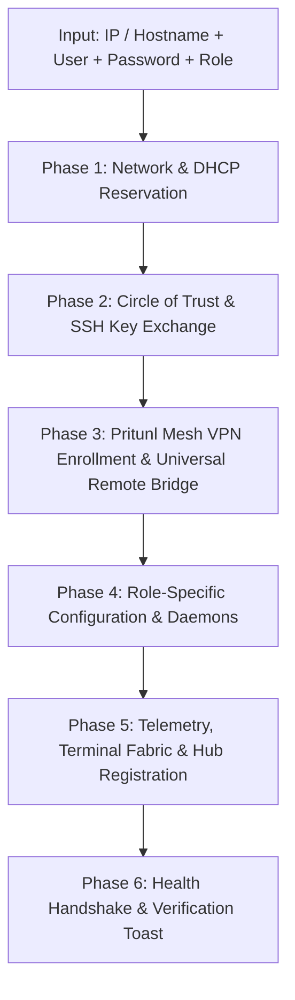

# DINGO Autonomous Edge Cluster: Node Provisioning Specification
**Document Version:** 1.1.0  
**Target Cluster:** DINGO Mesh (`van01`, `van02`, `brain01`, `node01`, `server01`, `omada-gw`)  
**Maintained by:** DINGO Swarm Architecture & Circle of Trust Enclave

---

## 1. Executive Overview

This document specifies the exact, standardized order of operations for onboarding, provisioning, and enrolling any new physical or virtual node into the DINGO Edge Cluster.

With this specification implemented, an administrator only needs to supply three minimal inputs via the Hub UI ("Add Node" Wizard) or CLI:
1. **Target Address:** IP address, hostname, or local FQDN (e.g., `192.168.0.109` or `node02.local`).
2. **Admin Username:** SSH user with sudo privileges (e.g., `dingo`, `admin`, or `pi`).
3. **Authentication Credential:** Initial SSH password or temporary private key.
4. **Target Role:** Selectable operational role (see Section 2).

The automated orchestration engine carries out the 6-phase pipeline without requiring manual intervention, registering the node into cluster routing, telemetry, web terminal fabric, VPN mesh, and container services.

---

## 2. Cluster Operational Roles & Profiles

When onboarding a new node, one of three primary roles is assigned:

### Role A: Primary / Secondary Edge Gateway
- **Target Hardware:** High-reliability SBCs (Raspberry Pi 5, Intel NUC, Protectli).
- **Core Capabilities:**
  - Participates in Keepalived Virtual Router Redundancy Protocol (VRRP) for Virtual IP `192.168.0.200` (`hub.local`).
  - Runs Caddy reverse proxy with mTLS certificates and HTTP/2 + HTTP/3 support.
  - Hosts DINGO Hub Express core (`:5150`), WebSocket event bus, and sandboxed web runtimes (`:8080`-`:8083`).
  - Active participant in cluster leader elections.

### Role B: Active Compute & Fabrication Worker
- **Target Hardware:** Workstations (`brain01`), 3D printing hosts (`node01`), GPU compute nodes.
- **Core Capabilities:**
  - Executes dedicated workloads (e.g., Ollama / Gemma 2 inference, Antigravity autonomous coding, Klipper / Moonraker 3D printing).
  - Telemetry reporting with hardware safety guards:
    - **Active Print Guard:** While Klipper/Moonraker is actively extruding on `node01`, background compute tasks are suppressed to prevent print stutter or timing jitter.
    - **Thermal & Memory Throttling:** Background jobs pause if CPU temperature exceeds 75°C or free RAM drops below 15%.

### Role C: Headless / Backup Node (Cold Standby & Storage Vault)
- **Target Hardware:** Low-power mini PCs, NAS devices, or secondary Pis with attached high-capacity storage.
- **Default State (Dormant):**
  - Web servers, container runtimes, and compute daemons remain **stopped / disabled** to conserve power and eliminate memory overhead.
  - MariaDB replica receives asynchronous replication binlogs or nightly dumps.
  - Periodic encrypted `rsync` pulls of `/home/dingo/projects/` and container volume snapshots.
- **Quorum Loss & Auto-Activation Policy:**
  - **Quorum Loss Condition:** If `van01`, `van02`, and `server01` are unreachable via ping, ARP, and VPN for $> 180$ seconds.
  - **Activation Mode 1 — Autonomous Disaster Recovery (Default):**
    - The node autonomously binds the Keepalived VIP `192.168.0.200`, activates the Caddy web server, launches MariaDB, and serves `hub.local` with an amber alert banner indicating `[DISASTER RECOVERY MODE - HEADLESS BACKUP ACTIVE]`.
  - **Activation Mode 2 — Admin Approval Gated:**
    - The node raises a local broadcast beacon or mobile alert. It awaits a signed cryptographic token or admin button click before launching database engines and claiming edge routing.

---

## 3. The 6-Phase Provisioning Pipeline (Order of Operations)



### Phase 1: Network Discovery & Static DHCP Reservation
1. **ARP & Ping Validation:**
   - Verify the target IP responds on LAN (`192.168.0.0/24`).
2. **Omada Gateway DHCP Binding:**
   - Connect to Omada ER706W gateway (`192.168.0.1`) API or CLI.
   - Detect the node's MAC address.
   - Reserve a permanent static IP in the cluster block (`192.168.0.100` – `192.168.0.119`):
     - `van01`: `192.168.0.106` (VIP `192.168.0.200`)
     - `van02`: `192.168.0.105`
     - `node01`: `192.168.0.107`
     - `brain01`: `192.168.0.108`
     - `node02`: `192.168.0.109` (assigned dynamically)
3. **Local DNS Mapping:**
   - Write `<hostname>.local` $\rightarrow$ assigned IP into Omada dnsmasq and local hosts files.

### Phase 2: Circle of Trust Bootstrap & SSH Mutual Enclave
1. **Initial SSH Connection:**
   - Establish initial connection using provided password or bootstrap key.
2. **Cluster Root CA & Authorized Keys Injection:**
   - Append DINGO cluster ed25519 public keys (`van01`, `van02`, `brain01`) to `~/.ssh/authorized_keys` on the new node.
3. **Node Identity Generation:**
   - If missing, generate `/etc/ssh/ssh_host_ed25519_key` and user key `~/.ssh/id_ed25519`.
   - Record node's public key in `/home/admin/.ssh/known_hosts` on all gateway nodes.
4. **Hardening:**
   - Disable SSH password authentication in `/etc/ssh/sshd_config.d/99-dingo-hardened.conf`:
     ```text
     PasswordAuthentication no
     PubkeyAuthentication yes
     PermitRootLogin prohibit-password
     ```
   - Reload sshd.

### Phase 3: Pritunl Mesh VPN Enrollment & Universal Remote Bridge (`lan0` / `tun0`)
1. **API Provisioning on `server01`:**
   - DINGO Hub queries the Pritunl API on `192.168.219.1` using cluster service credentials.
   - Creates a new user profile: `dingo-<hostname>`.
   - Generates and downloads the `.conf` or `.ovpn` configuration bundle.
2. **Client Installation & Remote Prerequisites on New Node:**
   - Linux package installation: `openvpn`, `resolvconf`, `iproute2`.
   - Ensure target profile directory `/etc/openvpn/client/` exists with `chmod 755 /etc/openvpn/client`.
   - Sudoer configuration in `/etc/sudoers.d/99-dingo-openvpn` for passwordless tunnel management:
     ```text
     %sudo ALL=(ALL) NOPASSWD: /bin/systemctl start openvpn-client@*, /bin/systemctl stop openvpn-client@*, /bin/systemctl restart openvpn-client@*, /bin/systemctl enable openvpn-client@*, /bin/systemctl disable openvpn-client@*, /bin/systemctl status openvpn-client@*
     ```
3. **Universal Remote Execution Bridge (Backend API Engine):**
   - The Hub backend (`api/server.js`) utilizes `getRemoteLinuxSsh(deviceId)` to dynamically dispatch management actions over authenticated SSH without requiring hardcoded device logic:
     - **Profile Discovery:** Remotely scans `/etc/openvpn/client/*.conf` via SSH and queries systemd active/enabled states plus `ip -j addr show` for `tun*` interfaces and IP bindings.
     - **Connect:** Executes `sudo systemctl start openvpn-client@<profile>` over SSH.
     - **Disconnect:** Executes `sudo systemctl stop openvpn-client@<profile>` over SSH.
     - **Autostart:** Executes `sudo systemctl enable/disable openvpn-client@<profile>` over SSH.
     - **Profile Upload:** Base64-transfers `.conf` directly to `/etc/openvpn/client/<name>.conf` with `chmod 600`.
     - **Profile Deletion:** Stops, disables, and deletes configuration files safely.
     - **Live Network Topology:** Inspects `ip -j addr show` and `ip -j -s link` on the remote node to dynamically register network interfaces (`wlan0`, `eth0`, `tun0`) and subnet memberships (`192.168.219.0/24`) into the cluster matrix.
4. **Verification Handshake & Dynamic Auto-Registration:**
   - Ping VPN gateway `192.168.219.1` over `tun0` / `lan0`.
   - Verify assigned IP in `192.168.219.0/24` range (e.g., `192.168.219.20`).
   - Dynamic IP auto-registration updates `devices.json` and in-memory registry automatically.

### Phase 4: Role-Specific Configuration & Daemons
- **If Role A (Edge Gateway):**
  - Install Keepalived, Caddy, Node.js 20.
  - Clone `/home/admin/van01-frontend` repository.
  - Configure Keepalived VRRP with priority 95.
- **If Role B (Compute / Fabrication Worker):**
  - If 3D printer: Install Moonraker API health probe and Klipper state monitor.
  - If GPU worker: Configure NVIDIA/OpenCL telemetry reporter and Ollama listener.
- **If Role C (Headless / Standby Backup):**
  - Configure `/etc/systemd/system/dingo-failover-watcher.service`.
  - Set up MariaDB replication slave or automated nightly ZFS/rsync volume sync.
  - Leave HTTP/Node services disabled until quorum failover trigger.

### Phase 5: Telemetry, Terminal Fabric & Hub UI Registration
1. **Telemetry Reporter Deployment:**
   - Deploy lightweight `/usr/local/bin/dingo-node-telemetry.py` running every 15 seconds.
   - Pushes metrics (CPU, RAM, temp, disk usage, active jobs) to `http://192.168.0.200:5150/api/telemetry/report`.
2. **Terminal Fabric Dispatcher (`hub-terminal-dispatch.sh`):**
   - Automatically append target case entry to `/home/admin/scripts/hub-terminal-dispatch.sh`:
     ```bash
     <node_id>)
       echo -e "\033[1;36m=== Connecting to <node_id> (<name>) ===\033[0m"
       exec ssh -o StrictHostKeyChecking=no -o ConnectTimeout=5 <user>@<ip>
       ;;
     ```
3. **Dynamic UI Registration:**
   - Append device record to `/home/admin/van01-frontend/config/devices.json` and memory store.
   - Hub UI automatically updates dropdowns, quick launch chips, and device fleet matrix.

### Phase 6: Health Handshake & Verification Toast
1. **Self-Test Probe:**
   - Ping LAN IP and VPN IP.
   - Test SSH non-interactive command execution (`uptime`, `uname -m`).
   - Query telemetry endpoint.
2. **Cluster Broadcast:**
   - Send WebSocket event `cluster:node_joined` with full device metadata.
   - Display success toast across all active browser sessions:  
     `"✔ Node [<node_id>] successfully provisioned and enrolled into Circle of Trust."`

---

## 4. Remote Node VPN Autonomic Bridge Architecture

```mermaid
flowchart LR
    UI["Hub Network UI (Browser)"] -->|POST /api/vpn/connect\nPOST /api/vpn/autostart\nPOST /api/vpn/upload| API["Express API Core (:5150)"]
    API -->|Inspect Device ID| Router{"Is Device Local?"}
    Router -->|van01| LocalSys["Local systemctl openvpn-client@*"]
    Router -->|Remote Linux (node01, van02, node02)| SshBridge["Universal Remote Linux SSH Engine\n(getRemoteLinuxSsh)"]
    Router -->|Windows (brain01)| WinMesh["Pritunl CLI / WinService"]

    SshBridge -->|Base64 Transfer| RemoteFs["/etc/openvpn/client/<profile>.conf"]
    SshBridge -->|sudo systemctl| RemoteSysd["Remote systemd openvpn-client@*"]
    SshBridge -->|ip -j addr show| RemoteNet["Remote Linux Kernel (tun0 / 192.168.219.x)"]

    RemoteNet -->|Live IP & Bytes| Telemetry["Cluster Route Matrix & Security Circle"]
```

### Architectural Principles:
1. **Zero Device Hardcoding**: The backend does not maintain hardcoded device cases. Any device listed in `devices.json` or discovered dynamically with `type: "server" | "node" | "sbc"` and an SSH address/username is automatically eligible for VPN control.
2. **Privilege-Separated Remote Execution**: Commands are issued over authenticated SSH keys as the admin/dingo user, executing only permitted `systemctl` actions via `/etc/sudoers.d/99-dingo-openvpn`.
3. **Real-Time Interface Telemetry**: The API directly polls `ip -j addr show` and `ip -j -s link` on the remote node, ensuring that assigned IP addresses, subnets, and rx/tx byte counters are live rather than simulated.

---

## 5. Disaster Recovery & Quorum Standby Matrix

| Scenario | Active Nodes | Backup Node Action | Estimated Recovery Time |
| :--- | :--- | :--- | :--- |
| **Normal Operations** | `van01`, `van02`, `brain01`, `server01` | Dormant storage replica; passive sync only | 0s (Idle) |
| **Primary Gateway Crash** | `van02` active; `van01` down | None; `van02` takes over VIP `192.168.0.200` via Keepalived | $< 1$ second |
| **Dual Gateway Failure** | `van01` & `van02` offline; `brain01` online | Headless backup receives quorum loss signal $\rightarrow$ launches local Caddy & claims VIP | $< 15$ seconds |
| **Total Cluster Isolation** | All gateways & cloud offline; Standby Node isolated | Standby Node enters Local Emergency Mode; serves `hub.local` for emergency repairs | $< 30$ seconds |

---
*Authored for the DINGO Cluster Ecosystem. Standardized for production deployment across vehicle, home lab, and cloud infrastructure.*
